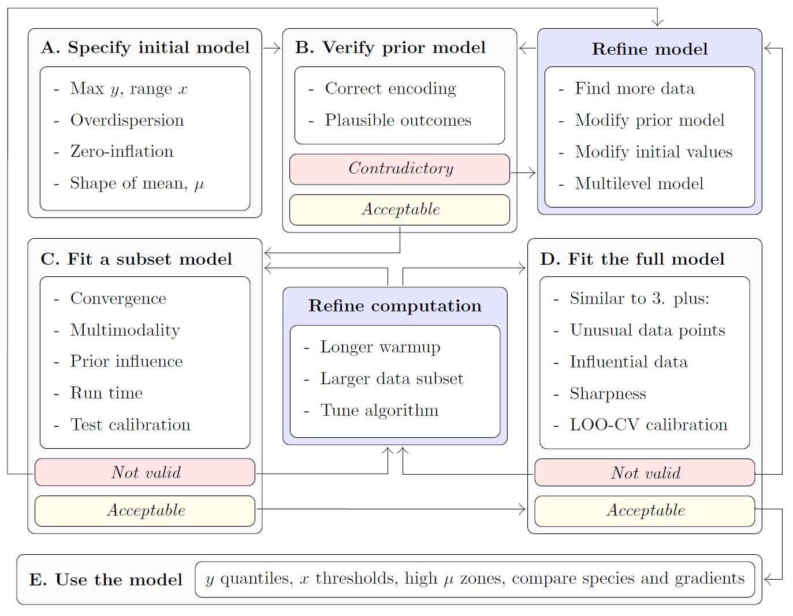
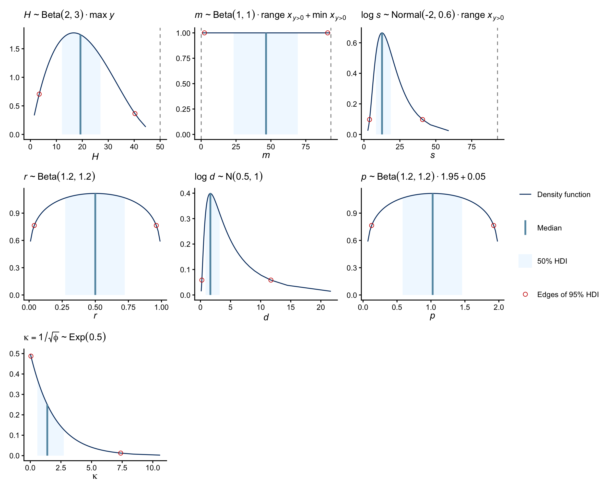
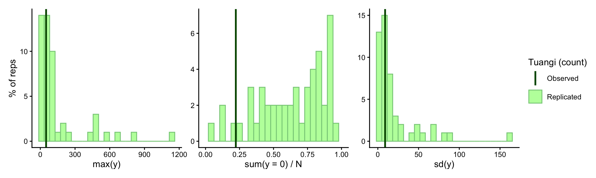
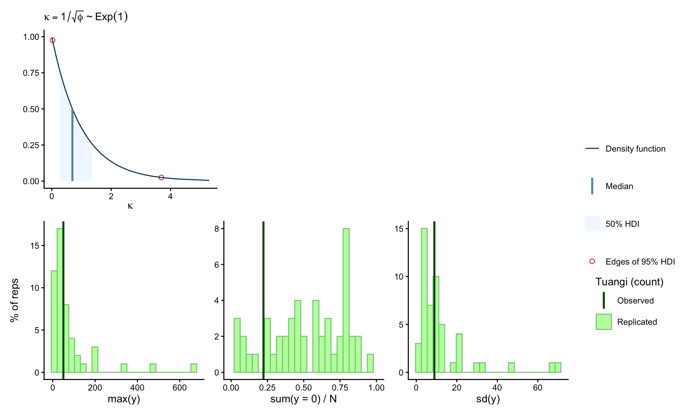
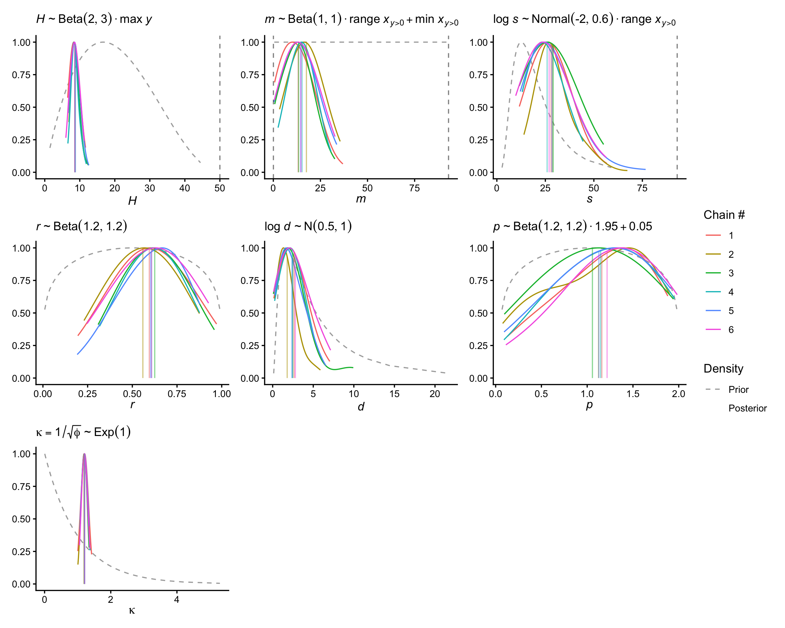
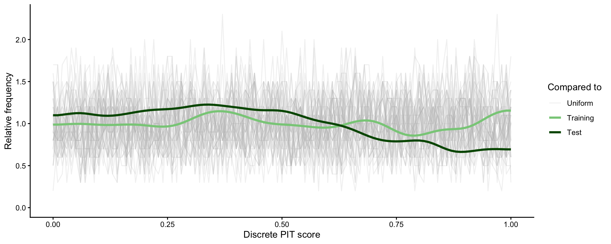
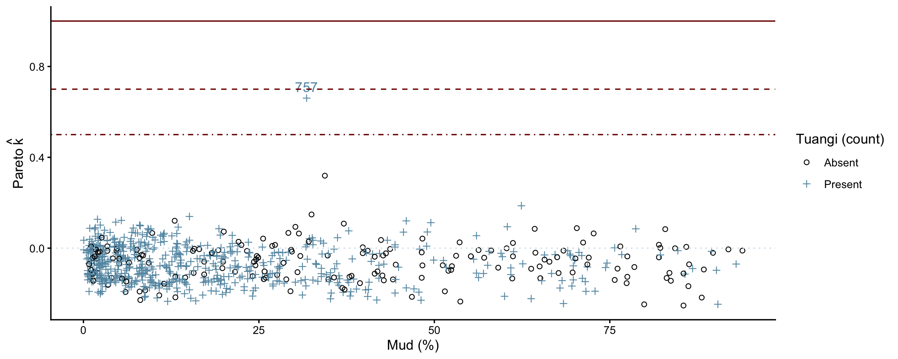
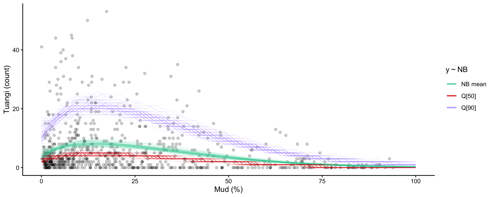
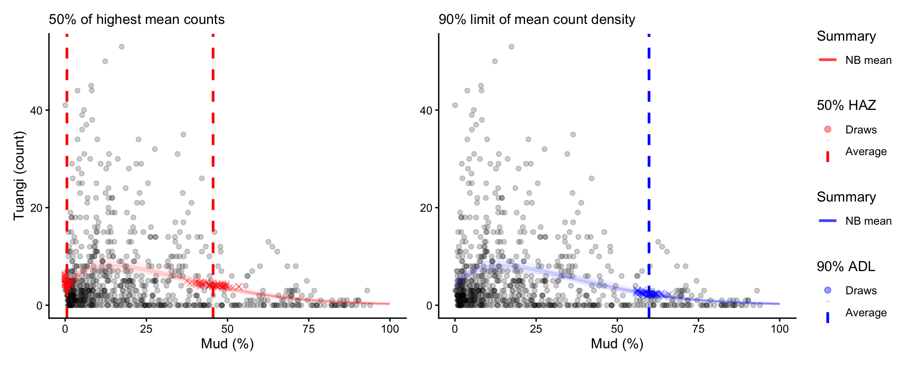

# Getting started

## Overview

This vignette presents a minimal Bayesian workflow for modelling the
distribution of discrete **species abundance**, $`y`$, along an
**environmental gradient**, $`x`$, using the **modskurt** function to
predict mean abundance, $`\mu`$. The diagram below outlines key steps
for an informative and trustworthy analysis using the `modskurt`
package, and also provides a layout for the rest of this vignette. If at
any stage you find yourself needing more information, please check out
the references and other resources on this web page.



## Load packages and stan files

This section assumes you’ve already got `modskurt` installed and
running, if not, jump over to this packages’ [home
page](https://hdrab127.github.io/modskurt/index.md).

``` r

# compile_stanmodels only runs when needed, so it doesn't hurt to keep these
# lines together in any analysis
library(modskurt)
compile_stanmodels()
```

    ## [1] "Compiling now: discrete.stan"

``` r

# everyone loves a good graph
library(ggplot2)
library(patchwork)
theme_set(theme_classic())

# for reproducibility
set.seed(123456)
```

## Case study - Tuangi vs. mud

To illustrate the `modskurt` workflow, we’ll analyse the distribution of
tuangi (*Austrovenus stutchburyi*, the New Zealand cockle - [more
info](https://niwa.co.nz/te-kuwaha/tuangi)) counts along a gradient of
estuarine sediment mud concentrations (from 0% no muddy sediment to 100%
completely mud dominated - [more
info](https://www.lawa.org.nz/learn/factsheets/estuaries/mud-content-in-estuaries/)).
Key variables are:

- `count` the number of individual tuangi recorded in a 250g composite
  sediment core.
- `mud_pct` the percentage of sediment particles in the core that are
  less than 0.063mm in diameter

``` r

data(tuangi)
tuangi
```

    ## # A tibble: 764 × 11
    ##    year    lon   lat count mud_pct tn_conc toc_pct tp_conc sst_min sst_avg
    ##    <chr> <dbl> <dbl> <dbl>   <dbl>   <dbl>   <dbl>   <dbl>   <dbl>   <dbl>
    ##  1 2017   175. -40.5     0    19.8     250    0.32     380    12.8    15.3
    ##  2 2018   175. -40.5     1    26.7     500    0.3      380    12.9    15.6
    ##  3 2017   175. -40.5     0    20       250    0.29     370    12.8    15.3
    ##  4 2018   175. -40.5     0    23.3     250    0.24     360    12.9    15.6
    ##  5 2017   175. -40.5     1    17.2     250    0.28     350    12.8    15.3
    ##  6 2018   175. -40.5     0    19.9     250    0.21     330    12.9    15.6
    ##  7 2017   175. -40.5     0    26.9     250    0.28     380    12.8    15.3
    ##  8 2018   175. -40.5     0    44.1     500    0.39     420    12.9    15.6
    ##  9 2017   175. -40.5     0    22.5     250    0.26     380    12.8    15.3
    ## 10 2018   175. -40.5     0    34.8     250    0.34     390    12.9    15.6
    ## # ℹ 754 more rows
    ## # ℹ 1 more variable: sst_max <dbl>

For attribution and technical details of how these data are collected,
please contact [Salt Ecology](https://www.saltecology.co.nz/contact).

## A. Specify initial model

The first step in the analysis of a species’ abundance over an
environmental gradient is to specify the distribution model. In general
for discrete abundance data like these, we recommend first trying a
**negative binomial** (NB) regression, however there may be some cases,
particularly for rare and hard to sample species, where it might be
worth going straight for a **zero-inflated negative binomial linked**
(ZINBL) extension – see [the ZINBL
article](https://hdrab127.github.io/modskurt/articles/linked-zero-inflation.md)
for an example.

Given the negative binomial distribution of abundance, $`y`$, the
`modskurt` package specifies that the mean of the negative binomial
distribution (or expected abundance $`\mu = \text{E}[y]`$) is a
non-linear function, $`f`$ of the environmental gradient, $`x`$, mud
content in this case. Yielding the following generalised non-linear
regression model (GNLM):

``` math
y_n \sim \text{NegativeBinomial}\left[\mu_n = f(x_n), \kappa\right]
```

where subscript, $`n`$, denotes the $`n`$th sample of abundance and
environmental gradient, and $`\kappa`$ is an overdispersion parameter
that models the variation of abundance relative to mean abundance.

The modskurt function, $`f`$, is visually unappealing, but (believe us!)
it produces appealing and realistic shapes of mean abundance along
environmental gradients:

``` math
f(x_n) =
  H \bigg[r \exp\left(\frac{1}{p}\left[\frac{x_n-m}{sr} - d\right]\right) + 
  (1 - r) \exp\left(\frac{1}{p}\left[d - \frac{x_n-m}{s\left(1 - r\right)}\right]\right) - \exp\left(-\frac{d}{p}\right) + 1\bigg] ^ {-p},
```

with parameters:

- $`H \in \mathbb{R}_{>0}`$: the strictly positive maximum height of the
  curve; the peak in mean abundance along the environmental gradient.
- $`m \in \mathbb{R}`$: the environmental location of peak mean
  abundance.
- $`s \in \mathbb{R}_{>0}`$: scales the width of the curve, describing
  how abundance decreases away from $`m`$.
- $`r \in (0, 1)`$: accounts for asymmetry, with $`r=0.5`$ indicating
  equal abundance in environmental conditions either side of $`m`$,
  $`r`$ below $`0.5`$ indicating more abundance below $`m`$, and $`r`$
  above $`0.5`$ indicating more abundance above $`m`$.
- $`d \in \mathbb{R}`$: controls the peakedness ($`d < 0`$) or broadness
  ($`d > 0`$, e.g. plateau-like shape) of the peak in mean abundance
  around $`m`$.
- $`p > 0`$: persists higher-levels of abundance in relatively extreme
  conditions; this is a similar effect to increasing the tail weight of
  a distribution function.

The effect of each parameter is best described visually, so please check
out this [Observable](https://observablehq.com/@hdrab127/nzm-model) if
you haven’t already and toggle through different parameter values. Not
all of these parameters are necessary for every analysis, but that
discussion is best illustrated in a future example.

Being a Bayesian model, we get to determine what values of each
parameter are realistic given the relationship we wish to model, rather
than whatever potentially unrealistic value fits the data best. This is
a huge benefit of Bayesian modelling, but also a huge hurdle when
dealing with complex parameter spaces like that of the model above. To
make life easier, the `modskurt` package suggests some default priors
that *should* just work 🤞:

``` math
\begin{align}
  H &\sim \text{Beta}(2, 3) \cdot \max y \\
  m &\sim \text{Beta}(1, 1) \cdot \text{range}~ x + \min x \\
  \log s &\sim \text{Normal}(-2.0, 0.6) + \log \text{range}~ x \\
  r &\sim \text{Beta}(1.2, 1.2) \\
  \log d &\sim \text{Normal}(0.5, 1.0) \\
  p &\sim \text{Beta}(1.2, 1.2) \cdot 1.95 + 0.05 \\
  \kappa &\sim \text{Exponential}(0.5), \\
\end{align}
```

However, we still need to check these in each and every model and will
be provide guidance on how to do this in section B.

Now finally, to specify this model in `R`, we use the
[`mskt_spec`](https://hdrab127.github.io/modskurt/reference/mskt_spec.md)
function:

``` r

spec <-
  mskt_spec(data = tuangi,
            # response and gradients (optional names for tidier outputs)
            y = c('Tuangi (count)' = 'count'),
            x = c('Mud (%)' = 'mud_pct'),
            # distribution of abundance
            dist = 'nb',
            # additional mean shape parameters to model, Hms are always required
            shape = 'rdp',
            # make predictions for every 1% of mud content
            pred_grid = 0:100,
            # check prior and initial fit on a subset of data
            subset_prop = 0.3)
```

The last argument, `subset_prop = 0.3`, defines the proportion of data
that will be used for the subset “fail fast” model in section C later
on.

We can print the model spec and defaults for interest, `hp_` refers to
the hyperparameter values that define the priors above.

``` r

str(spec)
```

    ## List of 21
    ##  $ sample_prior: int 0
    ##  $ hp_H        : num [1:2] 2 3
    ##  $ hp_m        : num [1:2] 1 1
    ##  $ hp_s        : num [1:2] -2 0.6
    ##  $ hp_r        : num [1:2] 1.2 1.2
    ##  $ hp_d        : num [1:2] 0.5 1
    ##  $ hp_p        : num [1:2] 1.2 1.2
    ##  $ use_r       : int 1
    ##  $ fix_r       : num 0.5
    ##  $ use_d       : int 1
    ##  $ fix_d       : num 0
    ##  $ use_p       : int 1
    ##  $ fix_p       : num 1
    ##  $ use_zi      : int 0
    ##  $ hp_kap      : num 0.5
    ##  $ hp_g0       : num [1:2] 3 1.5
    ##  $ hp_g1       : num 5
    ##  $ Nrep        : int 101
    ##  $ xrep        : int [1:101] 0 1 2 3 4 5 6 7 8 9 ...
    ##  $ subset      :function ()  
    ##  $ full        :function (prop = 1, seed = NULL)  
    ##  - attr(*, "pars")= chr [1:7] "H" "m" "s" "r" ...
    ##  - attr(*, "nms")=List of 3
    ##   ..$ y  : chr "Tuangi (count)"
    ##   ..$ x  : chr "Mud (%)"
    ##   ..$ eff: NULL
    ##  - attr(*, "dist")= chr "nb"
    ##  - attr(*, "shape")= chr "rdp"
    ##  - attr(*, "class")= chr [1:2] "mskt-spec" "list"

## B. Verify initial model specification

This step helps in a few key ways

1.  Provide greater transparency on the model assumptions and greater
    understanding of the model mechanics,
2.  Verify that the model **only** predicts results that make sense to
    the best of our ecological knowledge, i.e. we give no weight to
    illogical parameter values, and thus estimate better measures of
    uncertainty.
3.  Verify that the model predicts **all** results that might make
    sense, i.e. the prior distributions are not overly constraining the
    parameter space and biasing results/uncertainty away from
    potentially realistic outcomes.

The `modskurt` provides four checking functions:

- [`check_prior_dens`](https://hdrab127.github.io/modskurt/reference/check_prior_dens.md):
  Plot the marginal prior densities and check their probabilities align
  with reasonable values.
- [`check_prior_mskt`](https://hdrab127.github.io/modskurt/reference/check_prior_mskt.md):
  Randomly sample from the joint prior and check that predictions for
  the mean, $`\mu`$, contain all possible shapes and sizes.
- [`check_prior_dist`](https://hdrab127.github.io/modskurt/reference/check_prior_dist.md):
  Simulate $`y`$ replicates from the joint prior model and plot “severe
  tests” to check for overdispersion misspecification.
- [`check_prior_zero`](https://hdrab127.github.io/modskurt/reference/check_prior_zero.md):
  Predict rates of zero-inflation given the mean and check for
  believable relationships – more on this
  [here](https://hdrab127.github.io/modskurt/articles/linked-zero-inflation.md)

### Prior probabilities of parameter values

If you tweaked the default hyperparameters above, then you’ll want to
check they produce the correct marginal prior distribution here:

``` r

check_prior_dens(spec)
```



### Prior predictions for the `modskurt` mean

The default assumption of prior mean shapes look like a pile of
spaghetti, if you have information on any of the mean shapes you might
expect, then check they are reasonably covered here and that impossible
shapes are excluded, or at least weighted very heavily away from. We
highly recommend utilising this [`modskurt` prior specification
tool](https://hdrab127.github.io/modskurt/articles/modskurt-priors.md)
provided with the package for adjusting and verifying the model priors
in real time.

``` r

check_prior_mskt(spec)
```


Line opacity shows the prior probability of jointly observing the
parameters that predict that shape

### Prior predictions for summary statistics of `y`

Severe tests for the specified distribution of $`y`$ are useful to check
that the combination of mean shapes and overdisperion parameter,
$`\kappa`$, for

- Maximum observable counts: too much dispersion can produce counts that
  might be unrealistic or even impossible given the sampling design.
- Proportions of zeros: too much dispersion can also inflate the
  proportion of zeros beyond what might be credible, and cause
  underestimation of mean counts.
- Variation of abundance: too little dispersion (the Poisson effect) can
  restrict the model into overestimating mean counts in order to try and
  capture zero proportions or higher counts.

Similar to above, we have a another highly recommend tool for checking
and setting distribution priors on the [`ZINBL` prior specification
page](https://hdrab127.github.io/modskurt/articles/zinbl-priors.md).

``` r

check_prior_dist(spec)
```



In the middle subplot of the figure above, it looks maybe there are a
little too many zeros for this model? Tuangi are pretty common and it’d
be highly unlikely to not find a few somewhere along the mud gradient.
The maximum count predictions are quite high as well, counting more than
1500 tuangi in a single 250g sediment core would be quite a feat (unless
they are all tiny juveniles perhaps).

Lets tweak the rate hyperparameter for the exponentially distributed
overdispersion parameter,
$`\kappa \sim \text{Exp}[\lambda = \text{hp_kap}]`$, slightly to
encourage smaller values of overdispersion:

``` r

spec$hp_kap <- 1
check_prior_dens(spec, 'kap') + 
  check_prior_dist(spec) +
  plot_layout(design = 'A##\nBBB')
```



A little better, and a little is fine, remember the prior model should
fit knowledge of the tuangi-mud relationship, not specific data
realisations of it.

*OPTIONAL*: this whole section is an iterative process, take some time
and care here to make sure you are happy with the assumptions being
specified in your model.

## C. Fit subset model

The prior model looked okay, so it is time to consider the posterior.
The idea of this subset model section is to “fail fast”. That is, if we
missed any model misspecifications above, then instead of wasting your
time and computer resources fitting a full model right off the bat, we
can first fit a very quick approximate model that uses a subset of the
data and minimal posterior samples over maximal chains. Each chain will
roughly estimate the posterior for the subset of data, and hopefully
identify any issues with any likelihood degeneracies (multimodality
being a large concern for this highly parametrised model).

``` r

fit_subset <-
  mskt_fit(spec,
           # use the subset only
           use_subset = TRUE,
           iter_warmup = 200,
           iter_sampling = 100,
           chains = 6,
           parallel_chains = 6,
           # for testing
           show_messages = TRUE, show_exceptions = TRUE)
```

Check the computation diagnostics and refer to this excellent article on
[diagnosing Stan runtime
problems](https://mc-stan.org/misc/warnings.html).

``` r

check_computation(fit_subset)
```

    ## spec: nb[Hmsrdp] using 229 obs out of 762 (30% sample)
    ## post: 6 chains each with 100 draws (600 total)

    ## $summary
    ## # A tibble: 7 × 10
    ##   variable   mean median     sd    mad     q5    q95   rhat  ess_bulk  ess_tail
    ##   <chr>     <dbl>  <dbl>  <dbl>  <dbl>  <dbl>  <dbl> <rhat>     <ess>     <ess>
    ## 1 H         8.60   8.41  1.08   0.949   7.05  10.5     1.02 356 (0.6) 389 (0.6)
    ## 2 m        13.8   13.9   7.29   7.57    1.95  25.6     1.06 120 (0.2) 260 (0.4)
    ## 3 s        26.8   25.8   9.57   8.83   13.9   43.8     1.04 153 (0.3) 167 (0.3)
    ## 4 r         0.607  0.613 0.167  0.184   0.337  0.867   1.01 296 (0.5) 292 (0.5)
    ## 5 d         2.34   1.98  1.63   1.44    0.470  5.44    1.04 143 (0.2) 219 (0.4)
    ## 6 p         1.16   1.23  0.519  0.592   0.231  1.88    1.00 331 (0.6) 295 (0.5)
    ## 7 kap       1.21   1.20  0.0682 0.0715  1.10   1.32    1.01 609 (1.0) 469 (0.8)
    ## 
    ## $diagnostics
    ##   chain_id warmup sampling total num_divergent num_max_treedepth     ebfmi
    ## 1        1  0.616    0.238 0.854             0                 0 0.7933216
    ## 2        2  0.711    0.253 0.964             0                 0 1.3040569
    ## 3        3  0.605    0.257 0.862             2                 0 0.8282423
    ## 4        4  0.630    0.223 0.853             0                 0 1.1865072
    ## 5        5  0.691    0.264 0.955             0                 0 1.1901225
    ## 6        6  0.640    0.295 0.935             0                 0 0.8617386

*OPTIONAL*: refine the model specification or sampling settings.

### Check subset model

The model computation showed no reason for concern, so now we can look
at marginal posterior distributions for each chain of samples:

``` r

# visual display of chain mixing and prior-data conflicts
check_post_dens(fit_subset, by_chain = TRUE)
```



Given that each chain appears to find similar posterior solutions that
do not dramatically contradict the prior information, we can be
confident that the model is well specified for now.

Withholding data from the model computation also allows us to test the
predictive calibration of the posterior. Calibration refers to the
distance between the empirical distribution of the withheld DAEG data
and the posterior predictive distribution estimated from the training
data. For these discrete `zinbl` abundance distributions, we use the
randomised probability integral transformation (PIT) test of [Czado, C.,
Gneiting, T. and Held, L.,
(2009)](https://onlinelibrary.wiley.com/doi/abs/10.1111/j.1541-0420.2009.01191.x).

``` r

# uses test set for discrete pit
check_post_calibration(fit_subset)
```



For a model that accurately predicts new data, these PIT scores should
be uniformly distributed, and given that the PIT scores for the
posterior predictions of test data are well within the range of the
random uniform samples, we can be confident for now that the predictive
capability of the model is well calibrated.

*OPTIONAL*: this is your last chance to make sure you are happy with
model assumptions and the samplers ability to compute them.

## D. Fit full model

Time for comprehensive Bayesian inference, using the full dataset and a
large number of posterior samples.

``` r

fit_full <-
  mskt_fit(spec,
           chains = 4,
           parallel_chains = 4,
           # for testing
           show_messages = TRUE, show_exceptions = TRUE)
```

Check computation again, and compare to above.

``` r

check_computation(fit_full)
```

    ## spec: nb[Hmsrdp] using 762 obs out of 762 (100% sample)
    ## post: 4 chains each with 1000 draws (4000 total)

    ## $summary
    ## # A tibble: 7 × 10
    ##   variable   mean median     sd    mad     q5    q95  rhat   ess_bulk   ess_tail
    ##   <chr>     <dbl>  <dbl>  <dbl>  <dbl>  <dbl>  <dbl> <rha>      <ess>      <ess>
    ## 1 H         8.23   8.21  0.640  0.629   7.23   9.34      1 2170 (0.5) 2477 (0.6)
    ## 2 m        14.2   14.1   2.82   2.66    9.82  19.0       1 1472 (0.4) 1249 (0.3)
    ## 3 s        22.9   22.5   5.57   5.59   14.5   32.2       1 1353 (0.3) 1878 (0.5)
    ## 4 r         0.769  0.788 0.0960 0.0810  0.582  0.890     1 1471 (0.4) 1447 (0.4)
    ## 5 d         1.54   1.35  0.926  0.834   0.403  3.33      1 1408 (0.4) 1867 (0.5)
    ## 6 p         1.20   1.23  0.465  0.538   0.384  1.89      1 2585 (0.6) 2406 (0.6)
    ## 7 kap       1.19   1.19  0.0374 0.0382  1.13   1.25      1 3183 (0.8) 2534 (0.6)
    ## 
    ## $diagnostics
    ##   chain_id warmup sampling  total num_divergent num_max_treedepth     ebfmi
    ## 1        1  6.367    7.450 13.817             0                 0 0.9644336
    ## 2        2  6.369    6.675 13.044             0                 0 0.9802058
    ## 3        3  6.119    6.577 12.696             0                 0 0.7850348
    ## 4        4  6.299    6.770 13.069             0                 0 0.9579974

*OPTIONAL*:

### Check full model

Given the subset model appeared to be adequately specified, and the
computation diagnostics of the full model improved, we shouldn’t need to
do too many more checks here. To be thorough it wouldn’t hurt to run
through
[`check_post_dens`](https://hdrab127.github.io/modskurt/reference/check_post_dens.md),
[`check_post_dist`](https://hdrab127.github.io/modskurt/reference/check_post_dist.md),
[`check_post_zero`](https://hdrab127.github.io/modskurt/reference/check_post_zero.md),
[`check_post_calibration`](https://hdrab127.github.io/modskurt/reference/check_post_calibration.md),
but for this getting started vignette we will just show one additional
check.

Now that our posterior is estimated over the entire data set, we want to
make sure that the subset of data used earlier was a reasonable
representation of our full dataset. A useful check for this is to
consider the influence each data point has on the posterior. This is
somewhat similar to checking a linear regression residual plot, are
there data points that the model couldn’t predict very well, and is it
because those data points are really unusual, or because our model is
misspecified and the subset model checks didn’t pick it up.

``` r

check_post_influencers(fit_full)
```

    ##     pareto_khat Tuangi (count) Mud (%)
    ## 757        0.66              2      32



The model only struggled to predict one point, and the console printout
shows that there was nothing unusual about that point (count = 2, mud %
= 31.8) so it is safe to ignore. Later plots suggest that maybe around
30-34% mud content the data is not as dispersed as the rest, and would
likely clear up as more data is collected.

*OPTIONAL*: refine model spec or fit parameters. In some cases, the
posterior model could be well specified but simply hard to estimate, and
refining the computation may be necessary to determine this. Refinements
could include adjusting the length of the warmup period, or tuning
algorithm parameters such as the size of steps used to explore the
posterior curvature.

## E. Use the model

Now we can look at some predictions of specific interest:

- What does the distribution of tuangi over mud concentrations look
  like, and
- What ranges of mud concentrations correlate with higher abundances of
  tuangi.

### Plot summaries of the abundance distribution

This is the complete distribution, choose any summaries that are the
most informative for your analysis.

``` r

# plot the distribution of abundance along the gradient
abundance_dist(fit_full, summaries = c('mean', 'median', 'q90'))
```



### Calculate ranges of x for different percentages of abundance measures

Going back to our original question, what ranges of mud concentrations
are tuangi most abundant in? There’s two useful ways to look at this, we
could:

1.  Calculate a range of mud concentrations that correspond to the
    highest levels of predicted tuangi abundance (high-abundance-zone,
    HAZ), or
2.  Determine a limit of mud concentration beyond which less than a
    certain level of predicted total tuangi abundance resides
    (abundance-density-limit, ADL).

Loosely speaking we could interpret these ranges as,

1.  HAZ: mud concentrations that are more optimal for tuangi (or
    correspond to other optimal environmental conditions)
2.  ADL: a line in the sand (or mud) where we expect to find a
    proportion of the total population being sampled.

Other important arguments are `capture_pct` and `based_on`, where we
decide what percent of abundance (high zone or density) the range will
capture, and which distribution summary the range and percent are based
on. For example

- `based_on = 'mean'` use the predicted modskurt mean abundance.
- `based_on = 'q90'` use the 0.9 probability quantile of predicted
  abundance.

The choice of summary and capture percentages will depend on the
question being answered. For these data we might start by looking at the
range of mud concentrations where we expect to find 50% of the highest
average tuangi counts, so `capture_pct = 50`% `using_range = 'HAZ'`
`based_on = 'mean'` tuangi counts (the left hand red plot). And the
upper limit of mud concentrations beyond which there is less than
`capture_pct = 10`% of predicted tuangi density (`using_range = 'ADL'`)
`based_on = 'mean'` predicted counts.

``` r

# compose in row using patchwork
(abundance_range(fit_full,
                 capture_pct = 50,
                 using_range = 'HAZ',
                 based_on = 'mean',
                 plotted = TRUE,
                 range_colour = 'red') +
   labs(subtitle = '50% of highest mean counts')) + 
  (abundance_range(fit_full,
                   capture_pct = 90,
                   using_range = 'ADL',
                   based_on = 'mean',
                   # specify left or right side limit
                   region = 'left',
                   plotted = TRUE,
                   range_colour = 'blue') +
     labs(y = NULL, subtitle = '90% limit of mean count density')) +
  plot_layout(guides = 'collect')
```

    ## 
    ## Species range (see x.avg row) calculated as the region of x where the NB mean abundance (NB mean) is within 50% of the highest value of NB mean along x (averaged across posterior draws):
    ##                left      centre       right
    ## mean.avg 4.69006033  8.27600241  4.15045999
    ## mean.se  0.09993937  0.09603441  0.04807493
    ## x.avg    0.53352593 13.62000000 45.55078329
    ## x.se     0.09697448  0.35558517  0.52709780
    ## 
    ## Species range (see x.avg row) calculated as the smallest region of x where the density of NB mean abundance (NB mean) is equal to 90% of the total density of NB mean along x (averaged across posterior draws):
    ##               left     centre       right
    ## mean.avg 4.3363897  7.2081581  2.34696538
    ## mean.se  0.1335607  0.0801483  0.03973593
    ## x.avg    0.0000000 25.6444897 59.76365417
    ## x.se     0.0000000  0.1748294  0.33998849



The console printout shows that sediment with between about 0% and 46%
mud content has average tuangi counts within half (50%) of their peak
average counts.

Compare those numbers with the abundance density limit that suggest 90%
of predicted total mean tuangi abundance is found in sediment with less
than 60.7% mud content.

## Summary

This case study lightly stepped through the core steps in the `modskurt`
analysis of species abundance over environmental gradients. There are
many more checks that can be performed throughout, and a whole raft of
troubleshooting exercises for when your data doesn’t play as nicely as
these tuangi abundances did. Have a look through the other articles if
interested:

- [Linked zero-inflation
  (ZINBL)](https://hdrab127.github.io/modskurt/articles/linked-zero-inflation.md)
- [Modskurt
  priors](https://hdrab127.github.io/modskurt/articles/modskurt-priors.md)
- [ZINBL
  priors](https://hdrab127.github.io/modskurt/articles/zinbl-priors.md)
- [Stan discrete
  model](https://hdrab127.github.io/modskurt/articles/stan-model.md)
- [Examples](https://hdrab127.github.io/modskurt/articles/examples.md)
