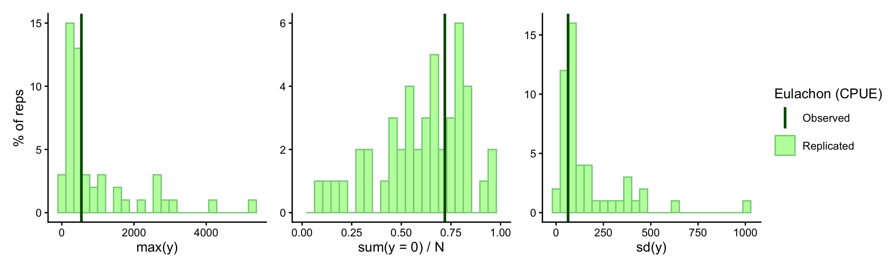
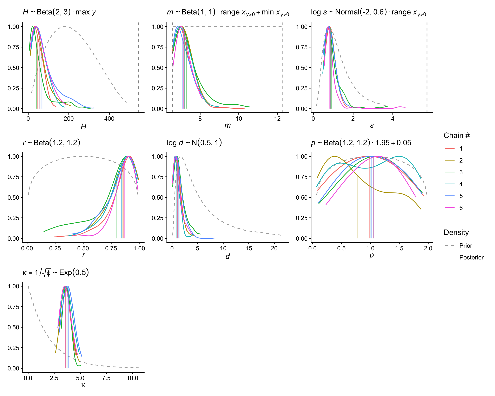
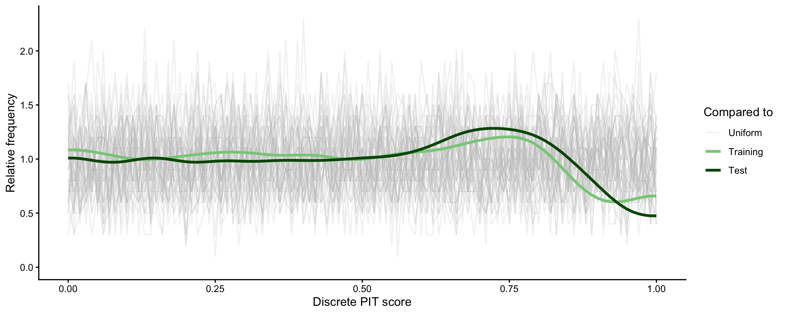
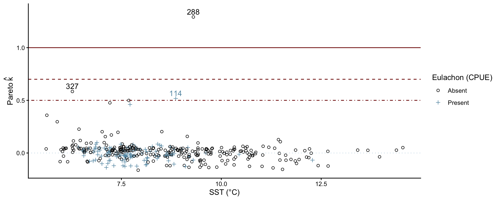
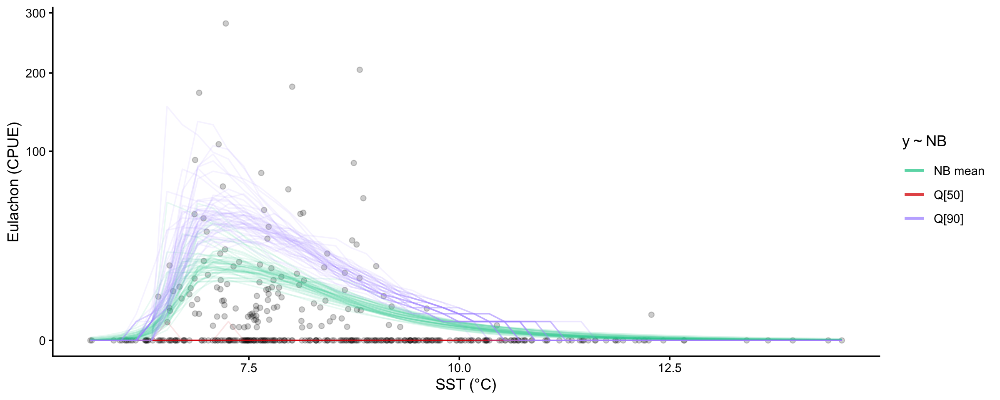

# Hierarchy of time

## Overview

This vignette presents a hierarchical Bayesian workflow for modelling
temporal (year-to-year) changes n the distribution of discrete **species
abundance**, $`y`$, along an **environmental gradient**, $`x`$, using
the **modskurt** function to predict mean abundance, $`\mu`$. The model
is specified as

…

## Load packages and stan files

This section assumes you’ve already got `modskurt` installed and
running, if not, jump over to this packages’ [home
page](https://hdrab127.github.io/modskurt/index.md).

``` r

# compile_stanmodels only runs when needed, so it doesn't hurt to keep these
# lines together in any analysis
library(modskurt)
compile_stanmodels()
```

    ## [1] "Already compiled: discrete.stan"

``` r

# everyone loves a good graph
library(ggplot2)
library(patchwork)
theme_set(theme_classic())

# for reproducibility
set.seed(123456)
```

## Case study - Eulachon vs. sea temperature over time

Use Northwest Pacific groundfish trawl survey data for *Thaleichthys
pacificus* (eulachon, or candlefish) over the ocean temperature
gradient - [more
info](https://www.fisheries.noaa.gov/west-coast/science-data/us-west-coast-groundfish-bottom-trawl-survey).
Key variables are:

- `total_count` the number of individual redstripes caught during each
  trawl.
- `temp` average water temperature recorded at the net during the trawl.
- `area_swept` total area (ha) of water swept during the trawl (trawl
  length \* net mouth diameter), this is the sampling **effort** used to
  observe `total_count`.
- `year` year in which the data was collected.

``` r

data(eulachon)
eulachon
```

    ## # A tibble: 2,430 × 8
    ##     year depth area_swept    do  temp   sal total_kg total_count
    ##    <dbl> <dbl>      <dbl> <dbl> <dbl> <dbl>    <dbl>       <dbl>
    ##  1  2012  57         1.70 4.58  12.5   33.6        0           0
    ##  2  2010  57.2       1.34 2.01   8.92  34.0        0           0
    ##  3  2012  57.6       1.70 1.03   8.50  34.0        0           0
    ##  4  2008  58.6       1.40 3.95  11.9   33.6        0           0
    ##  5  2013  58.6       1.51 3.10  10.5   33.6        0           0
    ##  6  2010  59.1       1.48 2.69  11.0   33.6        0           0
    ##  7  2013  59.2       1.55 0.819  8.71  34.0        0           0
    ##  8  2011  59.3       1.67 4.11  11.2   33.4        0           0
    ##  9  2010  59.4       1.57 2.39   8.55  33.8        0           0
    ## 10  2010  59.4       1.63 2.01   7.28  34.0        0           0
    ## # ℹ 2,420 more rows

## A. Specify initial model

We’ll start with the simplest model that ignores time for now,

``` math
\begin{aligned}
y_n &\sim \text{NB}\left[\text{area_swept} \cdot \text{Modskurt}(x_n), \kappa\right] \\
\end{aligned}
```

``` r

# specify simple model for latest year
spec <-
  mskt_spec(data = eulachon[eulachon$year == max(eulachon$year),],
            y = c('Eulachon (CPUE)' = 'total_count'),
            x = c('SST (°C)' = 'temp'),
            effort = c('Area swept (ha)' = 'area_swept'),
            dist = 'nb',
            shape = 'rdp',
            subset_prop = 0.3)
```

``` r

str(spec)
```

    ## List of 21
    ##  $ sample_prior: int 0
    ##  $ hp_H        : num [1:2] 2 3
    ##  $ hp_m        : num [1:2] 1 1
    ##  $ hp_s        : num [1:2] -2 0.6
    ##  $ hp_r        : num [1:2] 1.2 1.2
    ##  $ hp_d        : num [1:2] 0.5 1
    ##  $ hp_p        : num [1:2] 1.2 1.2
    ##  $ use_r       : int 1
    ##  $ fix_r       : num 0.5
    ##  $ use_d       : int 1
    ##  $ fix_d       : num 0
    ##  $ use_p       : int 1
    ##  $ fix_p       : num 1
    ##  $ use_zi      : int 0
    ##  $ hp_kap      : num 0.5
    ##  $ hp_g0       : num [1:2] 3 1.5
    ##  $ hp_g1       : num 5
    ##  $ Nrep        : int 50
    ##  $ xrep        : num [1:50] 5.62 5.8 5.98 6.16 6.35 ...
    ##  $ subset      :function ()  
    ##  $ full        :function (prop = 1, seed = NULL)  
    ##  - attr(*, "pars")= chr [1:7] "H" "m" "s" "r" ...
    ##  - attr(*, "nms")=List of 3
    ##   ..$ y  : chr "Eulachon (CPUE)"
    ##   ..$ x  : chr "SST (°C)"
    ##   ..$ eff: chr "Area swept (ha)"
    ##  - attr(*, "dist")= chr "nb"
    ##  - attr(*, "shape")= chr "rdp"
    ##  - attr(*, "class")= chr [1:2] "mskt-spec" "list"

## B. Verify initial model specification

### Prior probabilities of parameter values

``` r

# check_prior_dens(spec)
```

### Prior predictions for the `modskurt` mean

``` r

# check_prior_mskt(spec)
```

### Prior predictions for summary statistics of `y`

``` r

check_prior_dist(spec)
```



*OPTIONAL*: refine model spec further

## C. Fit subset model

``` r

fit_subset <-
  mskt_fit(spec,
           # use the subset only
           use_subset = TRUE,
           iter_warmup = 200,
           iter_sampling = 100,
           chains = 6,
           parallel_chains = 6,
           # for testing
           show_messages = TRUE, show_exceptions = TRUE)
```

``` r

check_computation(fit_subset)
```

    ## spec: nb[Hmsrdp] using 114 obs out of 381 (30% sample)
    ## post: 6 chains each with 100 draws (600 total)

    ## $summary
    ## # A tibble: 7 × 10
    ##   variable   mean median     sd     mad     q5     q95  rhat  ess_bulk  ess_tail
    ##   <chr>     <dbl>  <dbl>  <dbl>   <dbl>  <dbl>   <dbl> <rha>     <ess>     <ess>
    ## 1 H        56.6   42.9   47.3   30.8    13.1   152.     1.01 162 (0.3) 229 (0.4)
    ## 2 m         7.16   7.03   0.524  0.385   6.63    8.03   1.02 164 (0.3) 179 (0.3)
    ## 3 s         0.886  0.804  0.405  0.181   0.579   1.37   1.02 172 (0.3)  53 (0.1)
    ## 4 r         0.836  0.883  0.150  0.0965  0.508   0.978  1.02 169 (0.3)  75 (0.1)
    ## 5 d         1.12   0.868  0.968  0.648   0.189   2.95   1.01 358 (0.6) 342 (0.6)
    ## 6 p         0.993  0.998  0.519  0.654   0.183   1.78   1.05 179 (0.3) 215 (0.4)
    ## 7 kap       3.67   3.62   0.410  0.396   3.11    4.40   1.02 278 (0.5) 333 (0.6)
    ## 
    ## $diagnostics
    ##   chain_id warmup sampling total num_divergent num_max_treedepth     ebfmi
    ## 1        1  0.336    0.082 0.418             4                 0 0.9491969
    ## 2        2  0.334    0.111 0.445             2                 0 0.9173424
    ## 3        3  0.364    0.140 0.504             0                 0 0.5943937
    ## 4        4  0.444    0.113 0.557             0                 0 0.9384754
    ## 5        5  0.388    0.140 0.528             0                 0 1.0060421
    ## 6        6  0.365    0.142 0.507             1                 0 0.9422603

*OPTIONAL*: refine model spec or fit parameters

### Check subset model

``` r

# visual display of chain mixing and prior-data conflicts
check_post_dens(fit_subset, by_chain = TRUE)
```



``` r

# uses test set for discrete pit
check_post_calibration(fit_subset)
```



*OPTIONAL*: refine model spec or fit parameters

## D. Fit full model

``` r

fit_full <-
  mskt_fit(spec,
           chains = 4,
           parallel_chains = 4,
           # for testing
           show_messages = TRUE, show_exceptions = TRUE)
```

``` r

check_computation(fit_full)
```

    ## spec: nb[Hmsrdp] using 381 obs out of 381 (100% sample)
    ## post: 4 chains each with 1000 draws (4000 total)

    ## $summary
    ## # A tibble: 7 × 10
    ##   variable   mean median     sd    mad     q5    q95  rhat   ess_bulk   ess_tail
    ##   <chr>     <dbl>  <dbl>  <dbl>  <dbl>  <dbl>  <dbl> <rha>      <ess>      <ess>
    ## 1 H        20.3   18.1   8.95   6.79   10.5   36.4       1 2020 (0.5) 1868 (0.5)
    ## 2 m         7.02   7.03  0.196  0.182   6.67   7.32      1 1157 (0.3)  673 (0.2)
    ## 3 s         0.701  0.695 0.112  0.108   0.532  0.892     1 2253 (0.6) 2262 (0.6)
    ## 4 r         0.869  0.873 0.0568 0.0521  0.772  0.953     1 1146 (0.3)  770 (0.2)
    ## 5 d         1.49   1.34  0.873  0.861   0.345  3.11      1 1590 (0.4) 1981 (0.5)
    ## 6 p         0.966  0.942 0.508  0.610   0.204  1.82      1 2625 (0.7) 2139 (0.5)
    ## 7 kap       3.10   3.09  0.174  0.173   2.83   3.40      1 3049 (0.8) 2721 (0.7)
    ## 
    ## $diagnostics
    ##   chain_id warmup sampling total num_divergent num_max_treedepth     ebfmi
    ## 1        1  2.760    2.576 5.336             0                 0 0.8657852
    ## 2        2  2.896    2.774 5.670             1                 0 0.8328147
    ## 3        3  2.923    2.918 5.841             2                 0 0.8061614
    ## 4        4  3.372    2.818 6.190             0                 0 0.9000476

*OPTIONAL*: refine model spec or fit parameters

### Check full model

``` r

check_post_influencers(fit_full)
```

    ##     pareto_khat Eulachon (CPUE) SST (°C) Area swept (ha)
    ## 114        0.52              57      8.9             1.7
    ## 288        1.29               0      9.3             2.0
    ## 327        0.58               0      6.3             1.3



## E. Use the model

### Plot summaries of the abundance distribution

``` r

# plot the distribution of abundance along the gradient
abundance_dist(fit_full, summaries = c('mean', 'median', 'q90')) +
  scale_y_sqrt()
```



### Calculate ranges of x for different percentages of abundance measures

``` r

# compose in row using patchwork
# (abundance_range(fit_full,
#                  capture_pct = 50,
#                  using_range = 'HAZ',
#                  based_on = 'mean',
#                  plotted = TRUE,
#                  range_colour = 'red') +
#    labs(subtitle = '50% of highest mean counts')) + 
#   (abundance_range(fit_full,
#                    capture_pct = 90,
#                    using_range = 'ADL',
#                    based_on = 'mean',
#                    # specify left or right side limit
#                    region = 'left',
#                    plotted = TRUE,
#                    range_colour = 'blue') +
#      labs(y = NULL, subtitle = '90% limit of mean count density')) +
#   plot_layout(guides = 'collect')
```

## Summary
