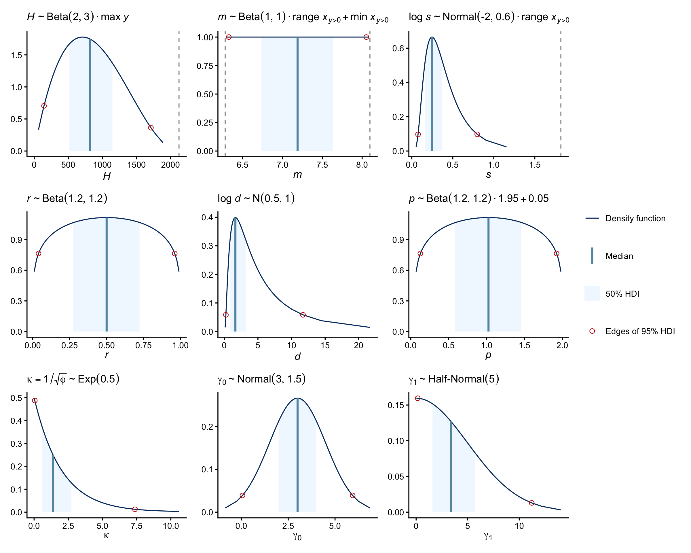
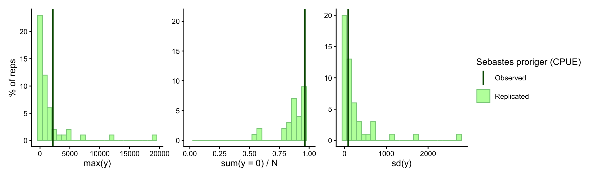
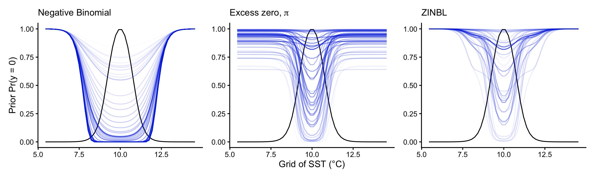
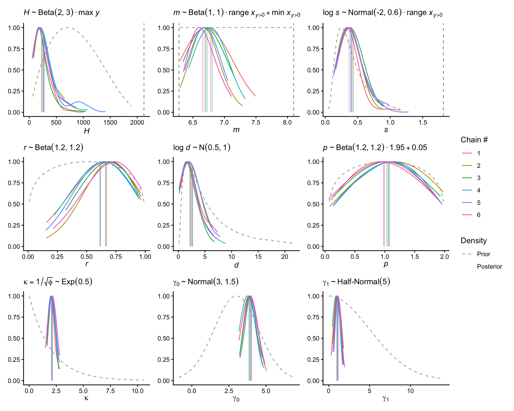
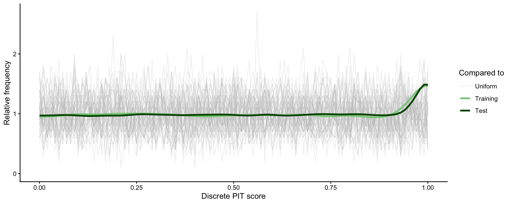
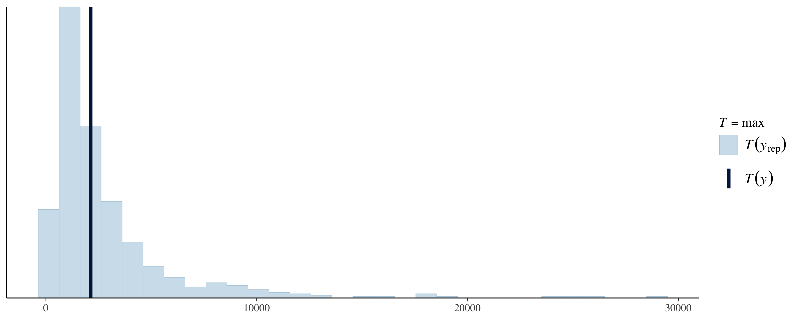
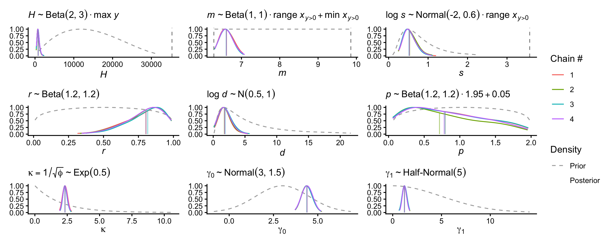
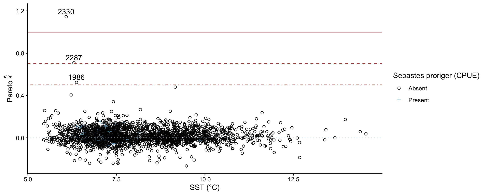
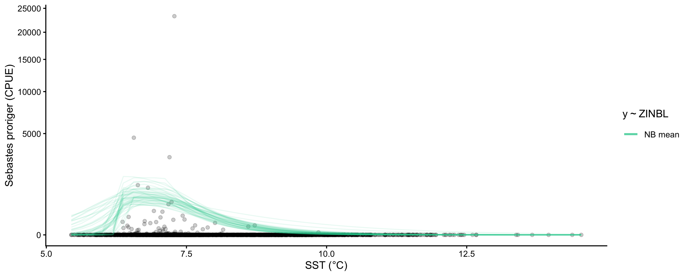
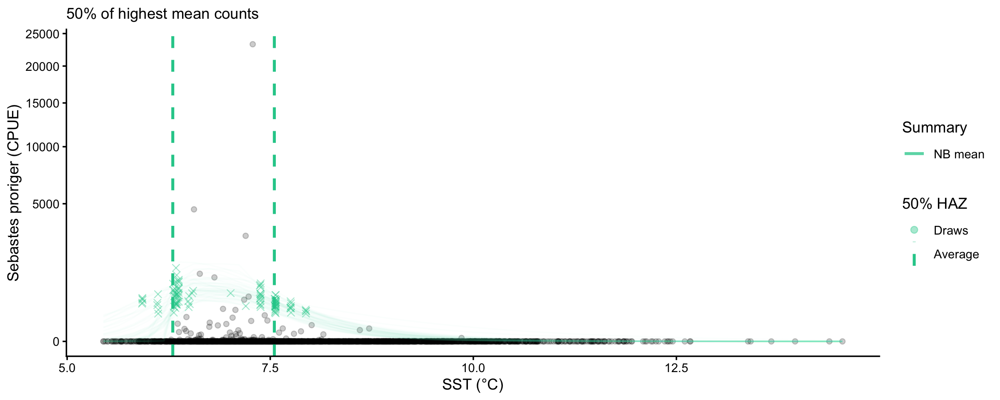

# Linked zero-inflation

## Overview

The [Getting started
article](https://hdrab127.github.io/modskurt/articles/getting-started.md)
showed how to model the negative binomial distribution of species
abundance along an environmental gradient using the `modskurt` mean
function. We’ve found that in the vast majority of species-environment
relationships, abundance can be reasonably characterised by a negative
binomial distribution. However, for very rare and hard to detect
species, there can be zero counts in “excess” of what the negative
binomial distribution *should* predict. We say *should*, because
mathematically, the negative binomial distribution can predict extremely
high proportions of zeros, although to achieve this we require extremely
high dispersion parameter values. Which is quite restricting in
practice, the mechanisms that can cause high zero proportions may not
also produce extremely disperse data.

To increase zero-rates, while maintaining realistic dispersion of
abundance, a zero-inflated negative binomial can be used where a point
probability mass is added at zero. This can work well in simple models,
but in generalised models like these `modskurt` ones, there is often a
relationship between mean abundance and zero rates in different
environmental conditions. For example, mean abundances and zero rates
are usually quite different in conditions where the species is commonly
found and easy to detect, versus intolerable conditions that are hard to
sample the species in. For this reason, the `modskurt` model utilises a
**z**ero-**i**inflated **n**egative **b**inomial with excess-zero
probability **l**inked (ZINBL) to mean abundances through a logistic
regression. The formula for this distribution will be covered later, as
we work through another case study.

## Load packages and stan files

``` r

library(modskurt)
compile_stanmodels()
```

    ## [1] "Already compiled: discrete.stan"

``` r

# everyone loves a good graph
library(ggplot2)
library(patchwork)
theme_set(theme_classic())

# for reproducibility
set.seed(123456)
```

## Case study - *Sebastes proriger* vs. water temperature

`ZINBL` distributions of abundance are typically most fruitful when
proportions of zeros are very high, like $`>0.95`$ high. A great example
of this is the Northwest Pacific groundfish trawl survey data for
*Sebastes proriger* (redstripe rockfish) over the ocean temperature
gradient - [more
info](https://www.fisheries.noaa.gov/west-coast/science-data/us-west-coast-groundfish-bottom-trawl-survey).
Key variables are:

- `total_count` the number of individual redstripes caught during each
  trawl.
- `temp` average water temperature recorded at the net during the trawl.
- `area_swept` total area (ha) of water swept during the trawl (trawl
  length \* net mouth diameter), this is the sampling **effort** used to
  observe `total_count`.

``` r

data(redstripe)
redstripe
```

    ## # A tibble: 2,330 × 8
    ##    date       depth area_swept    do  temp   sal total_kg total_count
    ##    <date>     <dbl>      <dbl> <dbl> <dbl> <dbl>    <dbl>       <dbl>
    ##  1 2012-07-14  57         1.70 4.58  12.5   33.6        0           0
    ##  2 2010-06-26  57.2       1.34 2.01   8.92  34.0        0           0
    ##  3 2012-06-30  57.6       1.70 1.03   8.50  34.0        0           0
    ##  4 2008-10-21  58.6       1.40 3.95  11.9   33.6        0           0
    ##  5 2013-07-20  58.6       1.51 3.10  10.5   33.6        0           0
    ##  6 2010-10-06  59.1       1.48 2.69  11.0   33.6        0           0
    ##  7 2013-06-29  59.2       1.55 0.819  8.71  34.0        0           0
    ##  8 2011-10-11  59.3       1.67 4.11  11.2   33.4        0           0
    ##  9 2010-09-16  59.4       1.57 2.39   8.55  33.8        0           0
    ## 10 2010-06-22  59.4       1.63 2.01   7.28  34.0        0           0
    ## # ℹ 2,320 more rows

## A. Specify initial model

The `ZINBL` distribution is defined as a mixture of the negative
binomial distribution and a bernoulli process with mixing proportion,
$`\pi`$ modelled as a decreasing logistic function of `modskurt` mean
abundance, $`\mu`$,

``` math
\begin{aligned}
y_n &\sim \text{ZINBL}\left[\mu_n = \text{Modskurt}(x_n), \kappa, \pi_n\right] \\
&= \pi_n \cdot (y_n == 0) + (1 - \pi_n) \cdot \text{NB}(\mu_n, \phi) \\
\text{logit}^{-1}~\pi_n &= \gamma_0 - \gamma_1 \cdot \mu_n
\end{aligned}
```

with new parameters:

- $`\gamma_0 \in \mathbb{R}`$: log-odds intercept for the probability of
  observing an excess-zero,
- $`\gamma_1 > 0`$: describes the rate at which the excess-zero
  probability decreases as the average abundance increases. As
  $`\gamma_0 \to 0`$ or $`\gamma_1 \to \infty`$, $`\pi \to 0`$ and the
  ZINBL reduces to the NB distribution.

Muck around with parameters
[here](https://salt-ecology.shinyapps.io/nb-zinbl-prior-specs/).

As with the negative binomial model, the `modskurt` package suggests
some default priors that *should* just work 🤞🤞:

``` math
\begin{align}
\kappa &\sim \text{Exponential}(0.5) \\
\gamma_0 &\sim \text{Normal}(3.0, 1.5) \\
\gamma_1 &\sim \text{HalfNormal}(5.0)
\end{align}
```

Note, now that we have sampling effort, we can internally standardise
counts to catch per unit effort (CPUE), $`y / \text{area_swept}`$, in
the model using

``` math
y_n \sim \text{ZINBL}\left[\text{area_swept} \cdot \mu_n, \kappa, \pi_n\right]
```

Specifying the model in `R`:

``` r

spec <-
  mskt_spec(data = redstripe,
            # total_count is being modelled as CPUE by including effort
            y = c('Sebastes proriger (CPUE)' = 'total_count'),
            x = c('SST (°C)' = 'temp'),
            effort = c('Area swept (ha)' = 'area_swept'),
            dist = 'zinbl',
            shape = 'rdp',
            subset_prop = 0.3)
```

A quick look at the model spec for the full dataset shows that the zero
proportion is about $`2252 / 2330 = 0.97`$:

``` r

str(spec$full())
```

    ## List of 4
    ##  $ train:List of 10
    ##   ..$ y          : int [1:2330] 0 0 0 0 0 0 0 0 0 0 ...
    ##   ..$ x          : num [1:2330] 7.49 11.78 7.01 6.45 11.05 ...
    ##   ..$ eff        : num [1:2330] 1.4 1.69 1.44 1.64 1.66 ...
    ##   ..$ N          : int 2330
    ##   ..$ Nz         : int 2252
    ##   ..$ x_range    : num 9.1
    ##   ..$ x_pos_range: num 3.57
    ##   ..$ x_min      : num 5.45
    ##   ..$ x_pos_min  : num 6.28
    ##   ..$ y_max      : int 35314
    ##  $ all  :'data.frame':   2330 obs. of  4 variables:
    ##   ..$ y  : int [1:2330] 0 0 0 0 0 0 0 0 0 0 ...
    ##   ..$ x  : num [1:2330] 12.45 8.92 8.5 11.85 10.51 ...
    ##   ..$ eff: num [1:2330] 1.7 1.34 1.7 1.4 1.51 ...
    ##   ..$ set: chr [1:2330] "train" "train" "train" "train" ...
    ##  $ prop : num 1
    ##  $ seed : NULL

## B. Verify initial model specification

This is very much the same as in [getting
started](https://hdrab127.github.io/modskurt/articles/getting-started.md),
except now we can have a look at the new linked zero inflation
parameters, and the excess-zero probabilities they predict.

### Prior probabilities of parameter values

``` r

check_prior_dens(spec)
```



### Prior predictions for the `modskurt` mean

Note above that values for `m` are by default constrained within the
range of `x` that had at least one non-zero abundance, `y`, recorded.
The effect of this is quite visible when looking at prior predictions
for mean abundance:

``` r

check_prior_mskt(spec)
```


Line opacity shows the prior probability of jointly observing the
parameters that predict that shape

### Prior predictions for summary statistics of $`y`$

Dispersion is a little high again?

``` r

check_prior_dist(spec)
```



### Prior predictions for probability of excess zero $`\pi`$

This is a new test, showing how excess-zero probabilities interact with
mean abundances using a simple bell-shaped mean shape (black line). The
shape of the mean here doesn’t really matter, it’s more about looking at
how excess probabilities decrease relative to mean abundance. The
difference between zero-probabilities for the plain `nb` are strikingly
lower than that of the `zinbl`, where `nb` zero-probability quickly
reduces as the mean increases, while the `zinbl` model keeps it a lot
higher till mean abundances almost reach their peak:

``` r

check_prior_zero(spec)
```



*OPTIONAL*: refine model spec further

## C. Fit subset model

Hopefully you’re happy with the model specification and prior checks
above? So we can proceed to some posterior checks using a “subset”
mudel:

``` r

fit_subset <-
  mskt_fit(spec,
           use_subset = TRUE,
           iter_warmup = 200,
           iter_sampling = 100,
           chains = 6,
           parallel_chains = 6,
           # for debugging
           show_messages = TRUE, show_exceptions = TRUE)
```

A few divergences like this raise an initial warning that the posterior
is not simple to compute. Summaries for the `m` parameter confirm this,
where some of the chains may not have mixed (independently sampled the
posterior parameter space):

``` r

check_computation(fit_subset)
```

    ## spec: zinbl[Hmsrdp] using 699 obs out of 2330 (30% sample)
    ## post: 6 chains each with 100 draws (600 total)

    ## $summary
    ## # A tibble: 9 × 10
    ##   variable    mean  median      sd     mad     q5     q95   rhat  ess_bulk
    ##   <chr>      <dbl>   <dbl>   <dbl>   <dbl>  <dbl>   <dbl> <rhat>     <ess>
    ## 1 H        269.    206.    196.    116.    90.6   665.      1.02 427 (0.7)
    ## 2 m          6.71    6.69    0.202   0.211  6.40    7.05    1.02 240 (0.4)
    ## 3 s          0.394   0.366   0.165   0.137  0.195   0.684   1.02 326 (0.5)
    ## 4 r          0.665   0.676   0.179   0.197  0.363   0.923   1.01 380 (0.6)
    ## 5 d          2.34    1.88    1.69    1.40   0.455   5.91    1.01 290 (0.5)
    ## 6 p          1.04    1.05    0.524   0.629  0.189   1.88    1.02 429 (0.7)
    ## 7 kap        2.09    2.07    0.256   0.273  1.70    2.52    1.01 502 (0.8)
    ## 8 g0[1]      3.92    3.89    0.354   0.317  3.39    4.55    1.02 304 (0.5)
    ## 9 g1[1]      1.06    1.06    0.287   0.289  0.601   1.54    1.03 228 (0.4)
    ## # ℹ 1 more variable: ess_tail <ess>
    ## 
    ## $diagnostics
    ##   chain_id warmup sampling total num_divergent num_max_treedepth     ebfmi
    ## 1        1  1.646    0.589 2.235             4                 0 0.8299444
    ## 2        2  1.578    0.624 2.202             1                 0 0.7685627
    ## 3        3  1.784    0.609 2.393             1                 0 1.1386688
    ## 4        4  1.812    0.681 2.493             3                 0 0.9649392
    ## 5        5  1.672    0.755 2.427             3                 0 0.8333944
    ## 6        6  1.764    0.705 2.469             4                 0 0.8922780

*OPTIONAL*: refine model spec or fit parameters

### Check subset model

To dig deeper into the high `rhat`, $`\hat{R}`$, values for `m` we can
look at the marginal posterior distributions for each chain:

``` r

# visual display of chain mixing and prior-data conflicts
check_post_dens(fit_subset, by_chain = TRUE)
```



The `m` issue isn’t apparent visually, there’s something with `m` and
`r` discussed in thesis.

Moving forward, we can compare the CDF of the posterior predictive
distribution vs the empirical CDF’s of the training and test data using
a discrete probability integral transform plot:

``` r

# uses test set for discrete pit
check_post_calibration(fit_subset)
```



The little uptick at the end suggests that the posterior distribution
predicts both training (subset, seen) data and test (unseen) data well
up until the very highest counts, where it might be slightly
underdispersed (i.e., underpredicting max counts). We could check this
with the `bayesplot` package using similar methods as `check_prior_dist`
above.

``` r

bayesplot::ppc_stat(y = spec$subset()$train$y,
                    yrep = fit_subset$draws('y_rep', format = 'matrix'),
                    stat = 'max')
```



*OPTIONAL*: refine model spec or fit parameters

## D. Fit full model

Alright, some concerns with chains not mixing above, but not enough to
suggest gross posterior misspecification. It could just be that, with
the added complexity of the `zinbl` model and the sparser data, the
computation needs a little more time to learn the posterior curvature.
We do this by increasing the warm-up iterations to the default 1000 per
chain:

``` r

fit_full <-
  mskt_fit(spec,
           iter_warmup = 1000,
           iter_sampling = 1000,
           chains = 4,
           parallel_chains = 4,
           # we could also take smaller steps around the posterior using
           # adapt_delta > 0.8, but better to avoid if possible
           # for testing
           show_messages = TRUE, show_exceptions = TRUE)
```

Less divergences than before, increasing `adapt_delta` should clear
those. The parameter diagnostics all look good:

``` r

check_computation(fit_full,
                  # to save console space
                  hide_stats = c('mean', 'sd'))
```

    ## spec: zinbl[Hmsrdp] using 2330 obs out of 2330 (100% sample)
    ## post: 4 chains each with 1000 draws (4000 total)

    ## $summary
    ## # A tibble: 9 × 8
    ##   variable  median     mad      q5      q95   rhat   ess_bulk   ess_tail
    ##   <chr>      <dbl>   <dbl>   <dbl>    <dbl> <rhat>      <ess>      <ess>
    ## 1 H        789.    264.    471.    1436.         1 3236 (0.8) 2279 (0.6)
    ## 2 m          6.59    0.154   6.39     6.88       1 1698 (0.4) 1420 (0.4)
    ## 3 s          0.512   0.142   0.347    0.827      1 1519 (0.4) 2581 (0.6)
    ## 4 r          0.825   0.130   0.538    0.963      1 1836 (0.5) 2253 (0.6)
    ## 5 d          1.72    0.828   0.555    3.61       1 1288 (0.3) 1591 (0.4)
    ## 6 p          0.718   0.616   0.116    1.76       1 2542 (0.6) 1819 (0.5)
    ## 7 kap        2.33    0.143   2.10     2.59       1 3720 (0.9) 2581 (0.6)
    ## 8 g0[1]      4.38    0.253   4.00     4.81       1 2578 (0.6) 2659 (0.7)
    ## 9 g1[1]      1.20    0.186   0.914    1.52       1 2272 (0.6) 2246 (0.6)
    ## 
    ## $diagnostics
    ##   chain_id warmup sampling  total num_divergent num_max_treedepth     ebfmi
    ## 1        1 18.104   20.751 38.855            18                 0 0.9752564
    ## 2        2 17.878   20.385 38.263            20                 0 0.9312918
    ## 3        3 21.817   19.346 41.163            18                 0 0.9686105
    ## 4        4 16.733   20.122 36.855            21                 0 0.9457264

*OPTIONAL*: refine model spec or fit parameters

### Check full model

Can check the marginal posterior distributions for each parameter again:

``` r

check_post_dens(fit_full, by_chain = TRUE)
```



Much more certain, or precise. Using approximate leave-one-out
cross-validation (LOO-CV) we can identify data points the posterior
struggles to predict:

``` r

# can be slow for large N
check_post_influencers(fit_full)
```

    ##      pareto_khat Sebastes proriger (CPUE) SST (°C) Area swept (ha)
    ## 1986        0.52                        0      6.4             1.9
    ## 2287        0.71                        0      6.3             1.8
    ## 2330        1.14                        0      6.1             1.5



A few zero-counts in mid-range temperatures, possibly the complex
interaction between mean shape, dispersion, and linked zero-inflation
struggling ever so slightly.

*OPTIONAL*: refine model spec or fit parameters.

## E. Use the model

To the fun(ner) part!

### Plot summaries of the abundance distribution

We’ll plot the non zero-inflated `modskurt` mean here to get an idea of
what average redstripe CPUE would be in the absence of excess-zeros:

``` r

# plot the distribution of abundance along the gradient
abundance_dist(fit_full,
               include_zero_inflation = FALSE,
               summaries = c('mean')) +
  scale_y_sqrt()
```



### Calculate ranges of x for different percentages of abundance measures

And a quick look at the temperatures that have greater than half of the
highest predicted mean CPUE:

``` r

abundance_range(fit_full,
                capture_pct = 50,
                using_range = 'HAZ',
                based_on = 'mean',
                include_zero_inflation = FALSE,
                plotted = TRUE) +
  labs(subtitle = '50% of highest mean counts') +
  scale_y_sqrt()
```

    ## 
    ## Species range (see x.avg row) calculated as the region of x where the NB mean abundance (NB mean) is within 50% of the highest value of NB mean along x (averaged across posterior draws):
    ##                  left       centre        right
    ## mean.avg 562.56833971 800.29209800 414.59239958
    ## mean.se   35.07234158  41.24081152  23.52962282
    ## x.avg      6.30041427   6.61926922   7.55058097
    ## x.se       0.02242914   0.02134568   0.02648499



About $`6.3`$ to $`7.5`$ degree celsius, this may be useful, somewhere?

## Summary

This article stepped through the `modskurt` workflow with a ZINBL
(zero-inflated negative binomial with excess-zero probability linked to
the negative binomial mean) model of redstripe rockfish abundance at
different water temperatures. The ZINBL model is very powerful, but
possibly limited to very sparse data and careful prior specification to
reliably estimate a credible posterior over a more complex likelihood
surface.
